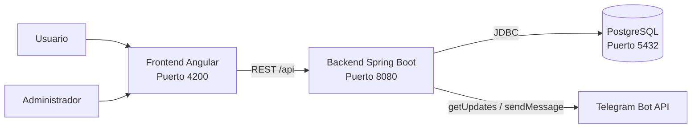

# Sistema de Denuncias Universitario


Sistema web para registrar, revisar y dar seguimiento a denuncias universitarias mediante Angular, Spring Boot, PostgreSQL y Telegram.

---

## Arquitectura



El proyecto está separado en tres módulos independientes:

| Módulo | Tecnología | Puerto |
|---|---|---:|
| `Database-SDU` | PostgreSQL 18 | `5432` |
| `Backend-SDU` | Spring Boot 4.1.2 / Java 25 | `8080` |
| `Frontend-SDU` | Angular 22 / Nginx | `4200` |

## Código de seguimiento y evidencias

Al registrar una denuncia, el sistema genera un código único de 10 caracteres sin letras o números ambiguos. El denunciante puede consultarlo desde `/consultar` sin iniciar sesión ni compartir su identidad.

El formulario ofrece un campo opcional para pegar uno o varios enlaces de evidencia. Los enlaces pueden generarse mediante [LimeWire](https://limewire.com/):

- El campo no es obligatorio.
- Varias URL pueden separarse por una línea.
- El denunciante conserva el control sobre los archivos alojados externamente.
- Los enlaces aparecen en el panel administrativo.
- La consulta pública devuelve el estado, la sede, la fecha y las evidencias, pero no datos personales ni la descripción completa.

La migración [`V3__seguimiento_y_evidencias.sql`](Database-SDU/migrations/V3__seguimiento_y_evidencias.sql) agrega las columnas de código y evidencias a denuncias existentes.

## Funcionalidades

- Registro público de denuncias por sede y rol.
- Generación de un código único alfanumérico para consultar el estado.
- Consulta pública del estado mediante el código de seguimiento.
- Envío opcional de enlaces a imágenes o videos almacenados en LimeWire.
- Consulta administrativa protegida con HTTP Basic.
- Búsqueda, paginación y estadísticas por sede.
- Mensajes personalizados y avisos automáticos por Telegram.
- Sincronización periódica de contactos desde Telegram.
- Jerarquía que impide retrocesos y cambios desde estados terminales.

## Sedes disponibles

Las sedes registradas actualmente son:

- SEDE 1
- SEDE 2
- POSGRADOS
- SEDE 3
- EUREKA
- LA PERLA
- ILE
- SEDE Campestre
- Sede Cúcuta

## Identidad visual

La interfaz utiliza la identidad institucional de la Universidad Simón Bolívar de Barranquilla:

- Verde principal `#05A64A` y verde oscuro `#05803B`.
- Acentos turquesa `#00BABF`, azul `#29A0D7` y naranja `#FF8000`.
- Logo local de la universidad.
- Cabecera institucional, navegación clara, botones verdes y contenido sobre fondos claros.

## Estados de una denuncia

```text
REGISTRADA -> ADMITIDA -> PROCESANDO -> PROCESADA
     \             \             \
      ----------------------------- RECHAZADA
```

- `RECHAZADA` impide cualquier cambio posterior.
- `PROCESADA` impide cualquier cambio posterior.
- Una denuncia activa puede cambiar a `RECHAZADA`.
- El backend impide retroceder y avanzar fuera de la jerarquía definida.

## Estructura

```text
Sistema de Denuncias Universitario/
├── Database-SDU/
│   ├── Dockerfile
│   └── migrations/
├── Backend-SDU/
│   ├── src/
│   ├── Dockerfile
│   └── pom.xml
├── Frontend-SDU/
│   ├── src/app/
│   ├── Dockerfile
│   ├── nginx.conf
│   └── package.json
├── compose.yaml
└── DOCUMENTACION_CODIGO.md
```

Más detalles técnicos: [`DOCUMENTACION_CODIGO.md`](DOCUMENTACION_CODIGO.md).

## Despliegue con Docker Compose

1. Crea un archivo `.env` en la raíz del repositorio:

```dotenv
DATABASE_PASSWORD=clave-segura-de-base-de-datos
SDU_ADMIN_USERNAME=admin
SDU_ADMIN_PASSWORD=clave-segura-del-administrador
TELEGRAM_BOT_TOKEN=
```

2. Construye y inicia los tres servicios:

```powershell
docker compose up -d --build
```

3. Accede a los servicios:

| Servicio | Dirección |
|---|---|
| Frontend | http://localhost:4200 |
| Backend | http://localhost:8080 |
| PostgreSQL | `localhost:5432` |

> [!IMPORTANT]
> No publiques `.env`, tokens, contraseñas ni credenciales en GitHub.


## Desarrollo local

### Requisitos

- Java 25
- Maven 3.9+
- Node.js 24.16+
- npm
- PostgreSQL 18 o Docker

### Base de datos

```powershell
docker compose up -d db
```

### Backend

```powershell
cd Backend-SDU
mvn spring-boot:run
```

### Frontend

```powershell
cd Frontend-SDU
npm install
npm start
```

El frontend usa el puerto `4200` y envía las solicitudes `/api` al backend en `http://localhost:8080`.

## Telegram

- `getUpdates` sincroniza automáticamente los usuarios que han iniciado una conversación con el bot.
- `sendMessage` envía avisos de creación y cambios de estado.
- La sincronización ocurre inmediatamente al iniciar el backend y se repite cada 30 segundos.
- Telegram funciona mediante polling; no necesita un webhook para esta configuración.

El usuario debe enviar al menos un mensaje nuevo al bot antes de vincular su username.

## Seguridad

- Las credenciales administrativas se suministran mediante `.env`.
- `/api/public/**` permite solicitudes públicas.
- `/api/admin/**` requiere autenticación administrativa.
- Termina TLS mediante un proxy confiable en producción.
